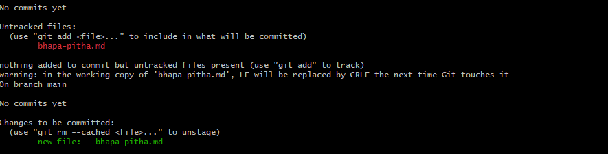
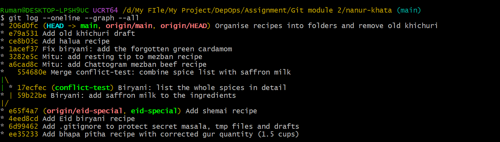

# নানুর খাতা: আমার Git যাত্রা

> নানুর পুরোনো রেসিপির খাতার পাতাগুলো ছিঁড়ে যাচ্ছিল। তাই ঠিক করলাম সব ডিজিটাল করব, আর কোনো রেসিপি যেন কখনো হারিয়ে না যায়। এই কাজে আমার সঙ্গী হলো Git, আর চট্টগ্রাম থেকে সাহায্য করল মিতু আপু।

---

## Chapter 1: প্রথম রেসিপি

নানু বললেন, "শীত আসছে, আগে ভাপা পিঠার রেসিপি লিখে ফেলো।"

### Task A: Git চিনিয়ে দেওয়া

```bash
git config --global user.name "baten2283"
git config --global user.email "baten2283@gmail.com"
mkdir nanur-khata && cd nanur-khata
git init
```

প্রথমে Git কে আমার নাম আর email বললাম, যাতে প্রতিটা commit এ আমার পরিচয় থাকে। এরপর `nanur-khata` ফোল্ডার বানিয়ে `git init` চালালাম। ফোল্ডারের ভেতর একটা লুকানো `.git` ফোল্ডার তৈরি হলো, ওটাই খাতার সব ইতিহাস জমা রাখবে।


### Task B: ফাইল বানিয়ে stage করা

```bash
git status
git add bhapa-pitha.md
git status
```

`bhapa-pitha.md` বানানোর পর প্রথম `git status` এ ফাইলটা **Untracked** (লাল) দেখাল, মানে Git ওকে চেনে না। `git add` করার পর সেটা **Changes to be committed** (সবুজ) এ চলে গেল। অর্থাৎ ফাইলটা এখন "commit এর লাইনে" দাঁড়িয়ে আছে।



### Task C: নানুর সংশোধন ("দুই কাপ না, দেড় কাপ গুড়!")

```bash
sed -i 's/2 cups gur/1.5 cups gur/' bhapa-pitha.md   # বা editor এ নিজে edit করো
git diff
git diff --staged
```

ফাইল stage করার পর গুড়ের পরিমাণ বদলালাম। তখন দুটো diff দুই রকম জিনিস দেখাল:

- `git diff` দেখায় **working directory vs staging area**। অর্থাৎ stage করার পর আমি নতুন কী বদলেছি। এখানে শুধু "2 cups gur" থেকে "1.5 cups gur" এর পরিবর্তনটা এল।
- `git diff --staged` দেখায় **staging area vs শেষ commit**। অর্থাৎ commit এ কী কী যেতে চলেছে। তখন পর্যন্ত কোনো commit ছিল না, তাই পুরো ফাইলটাই নতুন হিসেবে দেখাল (এবং তাতে পুরোনো "2 cups" ছিল, কারণ সংশোধন তখনও stage হয়নি)।

সহজ কথায়: প্রথমটা "এখনও stage করিনি এমন বদল", দ্বিতীয়টা "stage করে রাখা বদল"। এরপর `git add` দিয়ে সংশোধনটাও stage করলাম।

### Task D: প্রথম commit

```bash
git commit -m "Add bhapa pitha recipe with corrected gur quantity (1.5 cups)"
```

কেন বদলেছি সেটা message এ লিখে দিলাম, যাতে ভবিষ্যতে log দেখলেই বোঝা যায়।

### Task E: ভুল করে stage হওয়া bazar-list.txt

```bash
echo "chal, gur, narkel, elach" > bazar-list.txt
git add bazar-list.txt
git reset bazar-list.txt
git status
```

বাজারের তালিকা ভুলে stage করে ফেলেছিলাম। `git reset bazar-list.txt` দিয়ে ওকে staging area থেকে নামিয়ে আনলাম। ফাইলটা মোছা হয়নি, শুধু আবার Untracked হয়ে গেছে। `git status` এ সেটাই দেখা গেল।

---

## Chapter 2: গোপন মসলা

নানুর বিশেষ মসলার মিশ্রণ কোনোভাবেই GitHub এ যাওয়া চলবে না।

### Task A: গোপন ফাইল ও অন্যান্য

```bash
echo "SECRET: nanu's special masala blend" > secret-masala.txt
touch notes.tmp cache.tmp
mkdir draft && echo "half written idea" > draft/idea.md
```

### Task B: .gitignore

```gitignore
secret-masala.txt
*.tmp
draft/
```

```bash
git status
git check-ignore -v secret-masala.txt notes.tmp draft/idea.md
git add .gitignore bazar-list.txt
git commit -m "Add .gitignore to protect secret masala, tmp files and drafts"
```

`.gitignore` লেখার পর `git status` এ `secret-masala.txt`, `.tmp` ফাইল আর `draft/` কিছুই আর দেখা গেল না, শুধু `.gitignore` আর `bazar-list.txt` এল। `git check-ignore -v` দিয়ে প্রমাণও পেলাম, কোন নিয়মের কারণে কোন ফাইল বাদ পড়েছে।

একটা জরুরি কথা: `.gitignore` শুধু **এখনও track হয়নি** এমন ফাইলকে আটকায়। তাই secret ফাইল বানিয়েই আগে `.gitignore` লিখেছি, কখনো `git add` করিনি।

---

## Chapter 3: ঈদ স্পেশাল

মূল খাতা না ছুঁয়ে ঈদের রেসিপি পরীক্ষা করতে চাইলাম।

### Task A ও B: আলাদা branch এ কাজ

```bash
git branch eid-special
git checkout eid-special
# biryani.md বানিয়ে
git add biryani.md && git commit -m "Add Eid biryani recipe"
# shemai.md বানিয়ে
git add shemai.md && git commit -m "Add shemai recipe"
```

`eid-special` নামে নতুন branch বানিয়ে সেখানে গেলাম, তারপর বিরিয়ানি আর শেমাই আলাদা দুটো commit এ রাখলাম।

### Task C: main এ ফেরা ও merge

```bash
git checkout main
ls                        # biryani.md, shemai.md নেই!
git merge eid-special
ls                        # এখন আছে
git log --oneline --graph --all
```

`main` এ ফিরে `ls` দিতেই দেখি ফাইল দুটো **নেই**, কারণ commit গুলো শুধু `eid-special` এ ছিল। `git merge eid-special` করার পর ফাইল দুটো চলে এল। main এ ইতিমধ্যে নতুন কিছু ছিল না, তাই এটা **fast-forward** merge হলো। Git শুধু main এর পয়েন্টার সামনে সরিয়ে দিল, নতুন merge commit লাগেনি।

### Challenge: ইচ্ছা করে conflict বানানো

```bash
git checkout -b conflict-test
# biryani.md এর "Whole spices" লাইন বদলে commit
git commit -am "Biryani: list the whole spices in detail"

git checkout main
# একই লাইন অন্যভাবে বদলে commit
git commit -am "Biryani: add saffron milk to the ingredients"

git merge conflict-test      # CONFLICT!
```

দুটো branch এ **একই ফাইলের একই লাইন** দুইভাবে বদলালাম। merge করতেই Git থামিয়ে দিল, কারণ কোন সংস্করণ রাখবে সে বুঝতে পারছিল না। ফাইলটা দেখতে এমন হলো:

```
- Whole spices and saffron milk
- Whole spices: cardamom, cinnamon, cloves
```

- `<<<<<<< HEAD` থেকে `=======` পর্যন্ত হলো main এর সংস্করণ।
- `=======` থেকে `>>>>>>>` পর্যন্ত হলো conflict-test এর সংস্করণ।

**সমাধান:** আমি marker লাইনগুলো মুছে দুই সংস্করণের ভালো অংশ মিলিয়ে একটা লাইন বানালাম: `Whole spices: cardamom, cinnamon, cloves, plus saffron milk`। তারপর:

```bash
git add biryani.md
git commit -m "Merge conflict-test: combine spice list with saffron milk"
```

`git add` মানে "আমি conflict সমাধান করেছি", আর commit দিয়ে merge শেষ হলো। `git log --graph` এ দুই রাস্তা এক জায়গায় মিলে যাওয়ার ছবিটা পরিষ্কার দেখা গেল।

---

## Chapter 4: মিতু আপু যোগ দিল

### Task A: GitHub এ পাঠানো

GitHub এ `nanur-khata` নামে খালি repo বানালাম (README ছাড়া)।

```bash
git remote add origin https://github.com/baten2283/nanur-khata.git
git remote -v
git push -u origin main
git push origin eid-special
```

`git remote add origin` দিয়ে GitHub এর ঠিকানাটা `origin` নামে মনে রাখালাম। `-u` দিয়ে local main কে origin/main এর সঙ্গে বেঁধে দিলাম, যাতে পরে শুধু `git push` / `git pull` লিখলেই চলে।

### Task B: মিতু সেজে clone

```bash
cd ..
git clone https://github.com/baten2283/nanur-khata.git mitu-nanur-khata
cd mitu-nanur-khata
git config user.name "Mitu"
git config user.email "mitu@example.com"
# chittagong-mezban.md বানিয়ে
git add chittagong-mezban.md
git commit -m "Mitu: add Chattogram mezban beef recipe"
git push origin main
```

অন্য ফোল্ডারে clone করে মিতুর নামে (শুধু এই repo এর জন্য, `--global` ছাড়া) চট্টগ্রামের মেজবানের রেসিপি যোগ করে push করলাম।

### Task C: fetch করে merge

```bash
cd ../nanur-khata
git fetch origin
git log --oneline main..origin/main
git merge origin/main
```

`git fetch` মিতুর কাজ নামিয়ে আনল, কিন্তু আমার ফাইল বদলাল না। `git log main..origin/main` দিয়ে আগে দেখে নিলাম নতুন কী এসেছে। এরপর `git merge origin/main` করতেই `chittagong-mezban.md` আমার ফোল্ডারে চলে এল।

### Task D: git pull

মিতু আবার একটা tip যোগ করে push করল। এবার আমি একটা কমান্ডেই কাজ সারলাম:

```bash
git pull origin main
```

### প্রশ্ন: fetch + merge আর pull এর পার্থক্য কী?

`git pull` আসলে `git fetch` আর `git merge` এর সংক্ষিপ্ত রূপ। দুটোর পার্থক্য হলো নিয়ন্ত্রণে:

- **fetch + merge:** আগে শুধু remote এর খবর নামিয়ে আনি। তারপর `git log` / `git diff` দিয়ে দেখে নিই কী এসেছে, ঠিক মনে হলে তবেই merge করি। আমার কাজ নিরাপদ থাকে।
- **pull:** এক ধাক্কায় নামিয়ে এনেই সঙ্গে সঙ্গে merge করে ফেলে। দ্রুত, কিন্তু না দেখেই বদল আমার branch এ ঢুকে যায়, আর অপ্রত্যাশিত conflict ও হতে পারে।

নানুর খাতার মতো যত্নের কাজে আমি সাধারণত আগে fetch করে দেখে নিতে পছন্দ করব।

---

## Chapter 5: আধা-রান্না হালুয়া আর সময়ের ভ্রমণ

### Task A: stash

হালুয়ার রেসিপি অর্ধেক লেখার সময় নানু ফোন করে বললেন, "বিরিয়ানিতে এলাচ দিতে ভুলে গেছিস!"

```bash
git add halua.md
git stash
git status                # working tree clean
# biryani.md তে এলাচ যোগ করে
git commit -am "Fix biryani: add the forgotten green cardamom"
git stash pop
git add halua.md && git commit -m "Add halua recipe"
```

`git stash` অর্ধেক-লেখা হালুয়া তুলে রাখল, আর ফোল্ডার আবার পরিষ্কার হয়ে গেল। সেই ফাঁকে বিরিয়ানি ঠিক করে commit দিলাম। তারপর `git stash pop` দিয়ে হালুয়া ফিরিয়ে এনে লেখা শেষ করলাম। (নতুন ফাইল stash করতে হলে আগে `git add` করতে হয়, নইলে stash তাকে ধরে না।)


### Task B: ফোল্ডার সাজানো

```bash
mkdir -p recipes/pitha recipes/eid recipes/mezban
git mv bhapa-pitha.md recipes/pitha/
git mv biryani.md shemai.md halua.md recipes/eid/
git mv chittagong-mezban.md recipes/mezban/
git rm old-khichuri.md
git commit -m "Organise recipes into folders and remove old khichuri"
git log --stat -M -3
```

`git mv` ফাইল সরায় আর সঙ্গে সঙ্গে stage করে। `git rm` পুরোনো খিচুড়ির খসড়া মুছল। `git log --stat -M` এ দেখলাম Git এগুলোকে `rename ... (100%)` হিসেবে ধরেছে, অর্থাৎ ফাইলের ইতিহাস হারায়নি, শুধু জায়গা বদলেছে।

### Task C: git show

```bash
git show <SHA>     # আমি এলাচ-ঠিক-করার commit টা নিয়েছি
```

`git show` একটা commit এর সব কিছু দেখায়: কে লিখেছে, কখন, কী message, আর exact কোন লাইন বদলেছে (`-` পুরোনো, `+` নতুন)।

### Task D: reset --hard (শুধু test branch এ!)

```bash
git checkout -b test-reset
git log --oneline -4
git reset --hard <halua-commit-SHA>
git log --oneline -3
ls
git reflog
git checkout main
git branch -D test-reset
```

**কী হারালাম:** `reset --hard` করার পর test-reset branch থেকে শেষ দুটো commit উধাও হয়ে গেল: "Add old khichuri draft" আর "Organise recipes into folders...". ফোল্ডার সাজানোও মুছে গেল, সব ফাইল আবার আগের জায়গায় ফিরে এল। working directory ও পুরোপুরি পুরোনো অবস্থায় চলে গেল।

ভালো দিক হলো `main` এ কিছু হয়নি, ওখানে সব commit অক্ষত আছে। এছাড়া `git reflog` এ হারানো commit গুলোর SHA তখনও দেখা যাচ্ছিল, তাই চাইলে ফিরিয়ে আনা যেত। তবুও main এ এটা করার কথা ভাবাই যায় না।

### প্রশ্ন: shared branch এ rebase আর reset --hard বিপজ্জনক কেন?

দুটোই **ইতিহাস বদলে দেয়**, আর shared branch এ অন্যরাও সেই ইতিহাসের ওপর ভর করে কাজ করছে।

- **reset --hard:** commit মুছে ফেলে এবং working directory ও বদলে দেয়। এরপর force push করলে remote থেকেও commit গুলো হারিয়ে যায়। মিতু আপু যদি সেই commit এর ওপর কাজ করে থাকে, তার কাজের ভিত্তিই উধাও হয়ে যাবে।
- **rebase:** commit গুলো নতুন করে লেখে, ফলে তাদের SHA বদলে যায়। দেখতে একই মনে হলেও Git এর কাছে এগুলো একদম নতুন commit। আবার force push লাগে, আর অন্যদের local history remote এর সঙ্গে মিলবে না। ফলে duplicate commit, অদ্ভুত conflict, এমনকি অন্যের কাজ হারিয়ে যাওয়ার ঝুঁকি তৈরি হয়।

সোনালি নিয়ম: **যে commit অন্যের কাছে পৌঁছে গেছে, তার ইতিহাস বদলাবো না।** শুধু নিজের local, এখনও push না করা branch এ rebase/reset করা নিরাপদ।

---



GitHub repo: https://github.com/baten2283/nanur-khata.git
